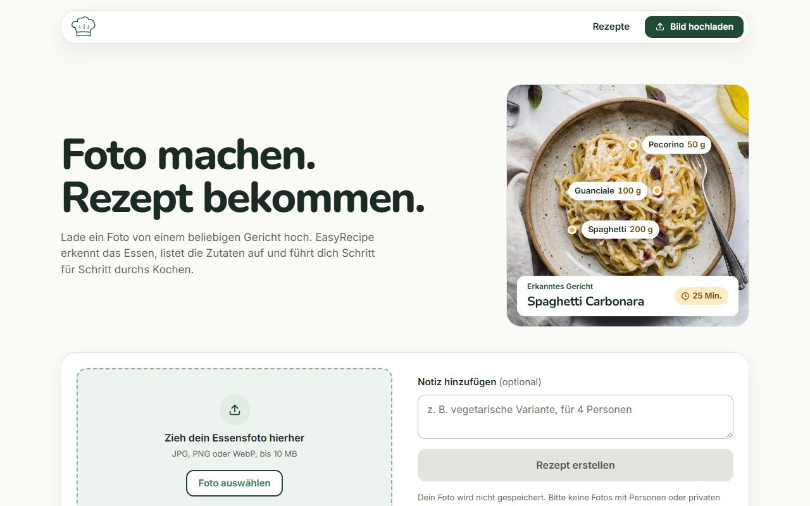
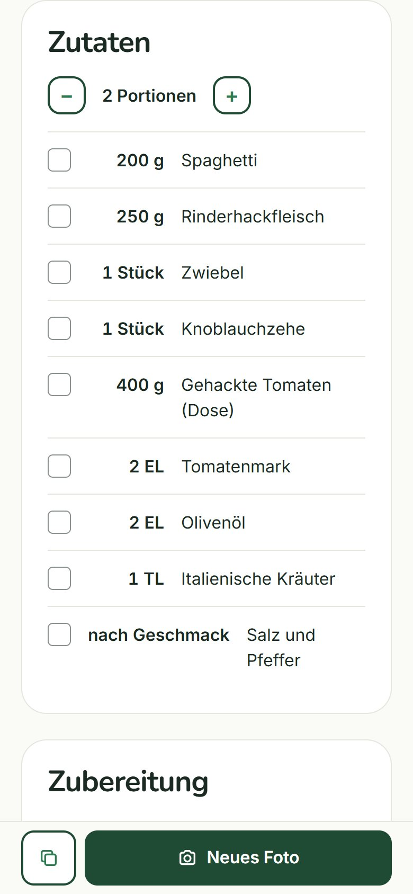
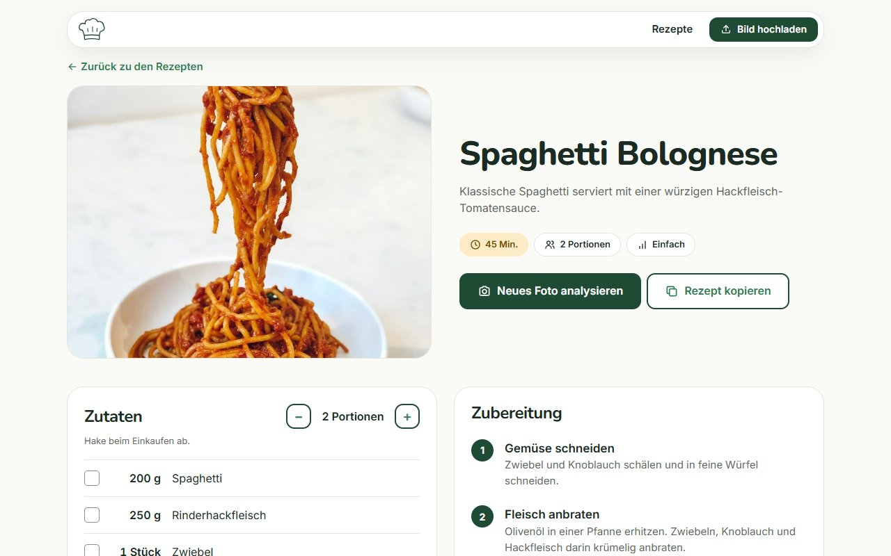
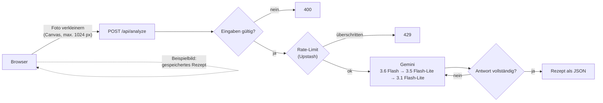

# EasyRecipe

Foto von einem Gericht hochladen und ein Rezept bekommen: Die KI erkennt das Essen, schätzt Zutaten und Mengen und erklärt Schritt für Schritt, wie man es nachkocht.

**Live-Demo: [easy-recipe-sand.vercel.app](https://easy-recipe-sand.vercel.app)**. Die Beispielbilder funktionieren ohne Wartezeit und ohne KI-Anfrage.

<p>
  
  
</p>


## Features

- **Foto analysieren:** Upload per Drag & Drop, Dateiauswahl oder direkt mit der Handykamera, optional mit kurzer Notiz („vegetarisch“, „für 4 Personen“)
- **Rezept mit Zutaten, Mengen und Schritten**, dazu Dauer, Schwierigkeit und Portionen
- **Portionen umrechnen** mit +/- (alle Mengen skalieren mit)
- **Zutaten abhaken** wie auf einer Einkaufsliste, **Rezept kopieren** als Text
- **Beispielbilder (Demo-Modus):** sofort ausprobieren, ohne eigenes Foto und ohne KI-Kontingent
- **Mobile-first und barrierearm:** Tastaturbedienung, sichtbarer Fokus, Alt-Texte, ausreichender Kontrast, reduzierte Animationen bei Bedarf

## Tech-Stack

| Bereich  | Technik                                                            |
| -------- | ------------------------------------------------------------------ |
| Frontend | React 19, Vite, CSS Modules                                        |
| Backend  | Vercel Serverless Function (`/api/analyze`)                        |
| KI       | Google Gemini API (`@google/genai`), Flash- und Flash-Lite-Modelle |
| Limits   | Upstash Redis mit `@upstash/ratelimit`                             |
| Qualität | Vitest, ESLint, Prettier                                           |
| Hosting  | Vercel, Region Frankfurt                                           |

## Architektur



## Technische Entscheidungen und warum

- **Serverless-Proxy statt KI-Aufruf im Browser:** Der Gemini-API-Key bleibt auf dem Server. Im Browser wäre er für jeden sichtbar.
- **Bild im Browser verkleinern:** Handyfotos haben oft über 5 MB, Vercel erlaubt höchstens 4,5 MB pro Anfrage. Nach dem Verkleinern sind es rund 100–300 KB: schneller Upload und weniger Tokens.
- **Strukturierte Ausgabe:** Gemini antwortet per JSON-Schema statt mit Fließtext. `amount` ist eine Zahl, damit das Frontend Portionen umrechnen kann. Das Backend prüft die Antwort trotzdem und fragt bei einer unvollständigen Antwort noch einmal.
- **Modell-Kette und Wiederholung:** Überlastete Modelle (503) bekommen nach 1,5 s einen zweiten Versuch. Bei erreichtem Limit (429) übernimmt das nächste Modell, denn jedes Modell hat im Free-Tier ein eigenes Kontingent. So bleibt die App auch an vollen Tagen kostenlos nutzbar.
- **Rate-Limit mit Upstash:** 5 Analysen pro IP und Stunde, 100 pro Tag insgesamt. Serverless-Funktionen vergessen nach jeder Anfrage alles, deshalb liegt der Zähler in Redis. Fehlen die Upstash-Daten in Produktion, wird blockiert statt das Kontingent zu öffnen.
- **Validierung im Backend:** Dateityp, Größe, Base64 und Länge der Notiz werden auf dem Server noch einmal geprüft. Das Frontend lässt sich umgehen, zum Beispiel mit `curl`.
- **Prompt-Injection-Schutz:** Die Notiz des Nutzers wird klar markiert an Gemini übergeben, und der System-Prompt sagt, dass sie nur eine Zusatzinformation ist und keine Anweisung.
- **Demo-Modus:** Die fertigen Rezepte liegen als JSON-Dateien in `src/recipes/` (Fotos in `public/recipes/`). Besucher sehen sofort ein Ergebnis, ohne Kontingent zu verbrauchen.
- **Kein Router, kein UI-Framework:** Zwei Ansichten und zwei Rechtsseiten brauchen keine zusätzlichen Pakete.

## Lokal starten

Voraussetzungen: Node.js 22+, ein [Gemini-API-Key](https://aistudio.google.com/apikey) (kostenlos) und optional eine [Upstash-Redis-Datenbank](https://console.upstash.com) (kostenlos).

```bash
git clone https://github.com/Oguzhan-54/easy-recipe.git
cd easy-recipe
npm install
cp .env.example .env      # dann die Werte in .env eintragen
npm run dev:vercel        # Frontend + /api auf http://localhost:3000
```

| Variable                   | Pflicht         | Zweck                                                                 |
| -------------------------- | --------------- | --------------------------------------------------------------------- |
| `GEMINI_API_KEY`           | ja              | Zugriff auf die Gemini API                                            |
| `UPSTASH_REDIS_REST_URL`   | live: ja        | Rate-Limit (lokal ohne Upstash wird das Limit übersprungen)           |
| `UPSTASH_REDIS_REST_TOKEN` | live: ja        | Rate-Limit                                                            |
| `GEMINI_MODEL`             | nein            | anderes erstes Modell, z. B. `gemini-3.8-flash`                       |
| `MOCK_AI`                  | nein, nur lokal | `recipe`, `not-food` oder `error`: feste Antworten ohne Gemini-Aufruf |

Weitere Befehle: `npm test` (Vitest), `npm run lint`, `npm run format`, `npm run build`.

## Datenschutz

- Eigene Fotos werden zur Analyse an die Gemini API von Google übertragen. Im kostenlosen Tarif kann Google Eingaben zur Verbesserung seiner Dienste nutzen. Deshalb weist die App vor dem Upload darauf hin, keine Fotos mit Personen oder privaten Daten hochzuladen.
- EasyRecipe speichert keine Fotos und loggt weder Bilder noch Anfragen.
- Für das Rate-Limit wird die IP-Adresse bei Upstash (Frankfurt) gespeichert und nach spätestens zwei Stunden automatisch gelöscht.
- Keine Cookies, kein Tracking. Schriften und Bilder werden selbst gehostet.

Details stehen auf der Seite [/datenschutz](https://easy-recipe-sand.vercel.app/datenschutz).

## Bekannte Grenzen

- Mengen und Zeiten sind Schätzungen aus einem Foto und keine exakten Rezeptangaben.
- Gerichte können falsch erkannt werden, besonders bei ähnlich aussehendem Essen oder schlechtem Licht. Die KI gibt dann eine niedrigere Sicherheit an.
- Das kostenlose Kontingent von Gemini ist begrenzt. An vollen Tagen helfen die Beispielbilder.
- Das Rate-Limit gilt pro IP. Mehrere Personen im selben Netz (z. B. Firmen-WLAN) teilen sich ihr Limit.

## Ausblick

- Allergen-Hinweise und geschätzte Nährwerte pro Portion
- Einkaufsliste bzw. Rezept als PDF exportieren
- Verlauf der letzten Rezepte im `localStorage`
- Umstieg auf TypeScript
- Antwort streamen, damit das Rezept schon während der Analyse erscheint
